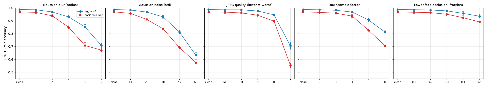

# Face verification robustness (LFW)

How much accuracy do pretrained face-verification models lose when the image is degraded? This repo measures that for two public models under five degradations, five severities each.

## Setup
- **Models:** facenet-pytorch `InceptionResnetV1`, pretrained on VGGFace2 and on CASIA-WebFace (no training done here).
- **Data and protocol:** LFW verification pairs (scikit-learn `fetch_lfw_pairs`, 6,000 pairs, 10 folds, cropped 125x94), cosine similarity on L2-normalised embeddings. The decision threshold is chosen on 9 folds and tested on the 10th; no labels are used at inference.
- **Degradations (same degradation on both images of a pair):** Gaussian blur, Gaussian noise (seeded), JPEG compression, downsample-then-upsample, and lower-face occlusion (black box over the lower part of the image, a rough proxy for a mask).
- **Metrics:** mean 10-fold accuracy (± std over folds) and ROC AUC. Chance accuracy is 0.5.
- Code: `robustness_eval.py` (about 15 to 25 minutes on a Colab T4).

## Clean baseline
| Model | Accuracy | AUC |
|---|---|---|
| VGGFace2 | 0.987 ± 0.004 | 0.999 |
| CASIA-WebFace | 0.969 ± 0.010 | 0.994 |



## Results (accuracy / AUC)
| Degradation | Level | Acc VGGFace2 | Acc CASIA | AUC VGGFace2 | AUC CASIA |
|---|---|---|---|---|---|
| Gaussian blur (radius) | 1 | 0.985 | 0.965 | 0.998 | 0.993 |
| Gaussian blur (radius) | 2 | 0.968 | 0.938 | 0.994 | 0.983 |
| Gaussian blur (radius) | 3 | 0.930 | 0.850 | 0.978 | 0.928 |
| Gaussian blur (radius) | 4 | 0.852 | 0.708 | 0.929 | 0.784 |
| Gaussian blur (radius) | 6 | 0.708 | 0.672 | 0.783 | 0.725 |
| Gaussian noise (std) | 10 | 0.983 | 0.957 | 0.998 | 0.991 |
| Gaussian noise (std) | 20 | 0.967 | 0.910 | 0.993 | 0.971 |
| Gaussian noise (std) | 30 | 0.930 | 0.837 | 0.979 | 0.915 |
| Gaussian noise (std) | 45 | 0.811 | 0.691 | 0.885 | 0.750 |
| Gaussian noise (std) | 60 | 0.632 | 0.576 | 0.676 | 0.609 |
| JPEG quality (lower = worse) | 50 | 0.985 | 0.967 | 0.998 | 0.993 |
| JPEG quality (lower = worse) | 30 | 0.985 | 0.961 | 0.998 | 0.992 |
| JPEG quality (lower = worse) | 15 | 0.976 | 0.943 | 0.996 | 0.985 |
| JPEG quality (lower = worse) | 8 | 0.946 | 0.896 | 0.985 | 0.958 |
| JPEG quality (lower = worse) | 3 | 0.705 | 0.555 | 0.783 | 0.586 |
| Downsample factor | 2 | 0.985 | 0.965 | 0.998 | 0.993 |
| Downsample factor | 3 | 0.981 | 0.959 | 0.997 | 0.991 |
| Downsample factor | 4 | 0.967 | 0.936 | 0.994 | 0.984 |
| Downsample factor | 6 | 0.906 | 0.826 | 0.963 | 0.910 |
| Downsample factor | 8 | 0.812 | 0.707 | 0.897 | 0.786 |
| Lower-face occlusion (fraction) | 0.1 | 0.986 | 0.966 | 0.999 | 0.993 |
| Lower-face occlusion (fraction) | 0.2 | 0.984 | 0.963 | 0.998 | 0.992 |
| Lower-face occlusion (fraction) | 0.3 | 0.977 | 0.951 | 0.997 | 0.988 |
| Lower-face occlusion (fraction) | 0.4 | 0.957 | 0.924 | 0.991 | 0.975 |
| Lower-face occlusion (fraction) | 0.5 | 0.935 | 0.891 | 0.979 | 0.952 |

## What the numbers show
- **Both models are close to unaffected by mild degradation.** Blur radius 1, noise std 10, JPEG quality 30 or higher, 2x downsampling and 10 to 30 percent lower occlusion all cost under 3 points.
- **Severe noise, blur and compression collapse accuracy.** At noise std 60 accuracy falls to 0.632 (VGGFace2) and 0.576 (CASIA); at JPEG quality 3 to 0.705 and 0.555 (near chance); at blur radius 6 to 0.708 and 0.672.
- **Lower-face occlusion costs the least at its highest severity.** Covering the bottom half still leaves 0.935 (VGGFace2) and 0.891 (CASIA), so these models rely heavily on the upper face.
- **The VGGFace2 model is more robust than the CASIA model at every level tested.** The gap widens at medium severity, for example noise std 45 (0.812 vs 0.691) and blur radius 3 (0.930 vs 0.850).
- **Heavy JPEG compression is the sharpest cliff:** accuracy drops from 0.976 at quality 15 to 0.705 at quality 3 for VGGFace2.

## Limitations
One run per condition (degradations are deterministic or seeded); fold standard deviations are the only variability reported. LFW is nearly saturated, so differences at the top end are small. Identity overlap between LFW and the pretraining sets was not checked. Two models only. Occlusion is a black box, not a real mask. Findings describe these two checkpoints under this protocol, not face recognition in general.

## Reproduce
```
pip install facenet-pytorch --no-deps scikit-learn matplotlib
python robustness_eval.py
```
Related: leakage-free benchmark of CNN backbones, github.com/abirhossain-dev/face-recognition-backbone-benchmark
